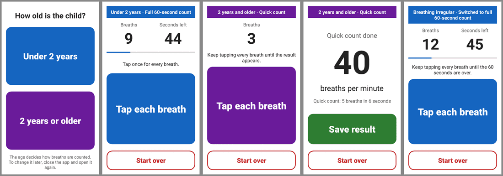

# Breath Counter for ODK


A small Android app for counting a child's respiratory rate. ODK Collect opens it from a form,
the health worker taps once for each breath, and **Save result** sends the rate back to the form.

It is modelled on Dimagi's [breath-counter](https://github.com/dimagi/breath-counter) for
CommCare. It has no third-party libraries, no network access and no sound files. The release
APK is under 30 KB and runs on Android 5.0 or newer.



## Two counting modes

The form chooses the mode from the child's age. A coloured banner shows the mode on every screen,
and there is no way to change it in the app.

**Full count (under 2 years, blue).** Tap at the first breath to start a 60-second timer, then tap
once for every breath. At 60 seconds the phone beeps three times and vibrates, and the rate is
the number of taps. The app also works out the quick-count rate from the same taps and returns
it separately, so the two methods can be compared later. Health workers never see that estimate.

**Quick count (2 years and older, purple).** Tap at every breath in. After each tap from the fifth
on, the app looks at the last 4 gaps between taps. When all 4 are within 13% of their median,
the rate is 60 seconds divided by the median gap, the phone beeps twice and the result appears,
usually after 5 or 6 breaths. This is the method and the best-performing settings from
[Karlen et al. 2014](https://pmc.ncbi.nlm.nih.gov/articles/PMC4053345/), as used by the RRate app.
If breathing is too irregular for a result within 12 taps, or a minute passes, the banner changes
to "Switched to full 60-second count" and counting continues to 60 seconds from the first tap.

Both modes: the beeps play on the alarm channel, so they are heard even when the phone is on
silent. **Start over** clears the count but keeps the mode. Leaving the screen mid-count (a phone
call, the home button, the power button) clears the count, because breaths would have been
missed. The back button returns to the form without saving anything. The screen stays on while
the app is open.

### Opening the app without a form

The app first asks "How old is the child?" with **Under 2 years** and **2 years or older**. The
answer sets the mode as above. To choose again, close the app and open it again. Nothing is
saved anywhere, so this is for practice and training.

## Using it in an ODK form

### What the app sends back

The app reads two launch parameters:

| Parameter | Values | Default |
|---|---|---|
| `mode` | `full` or `quick` | `full`. Any other value shows an error asking the user to tell their supervisor. |
| `prefix` | the name of the rate field | `resp_rate` |

On **Save result** it returns these extras. In an ODK intent group, each extra fills the field of
the same name:

| Extra | Value |
|---|---|
| `<prefix>` | the respiratory rate, breaths per minute |
| `<prefix>_method` | `full`, `quick`, or `full_after_quick` (quick count switched to a full count) |
| `<prefix>_quick` | full mode only: the quick-count rate from the same taps, for validation. Empty if breathing was never regular enough, and always empty in quick mode, where it would just repeat `<prefix>`. |
| `<prefix>_taps` | each tap's time in milliseconds from the first tap, separated by spaces, for example `0 1480 2950 4500 6020` |
| `value` | the rate, for a single `ex:` question |
| `odk_intent_data` | the rate, for CommCare |

`_quick` and `_taps` are always sent, even when empty, so launching again replaces values from an
earlier count.

### Weekly form

The weekly form already has the child's current age in months as `${age}`, pulled from the `wkl`
attachment (`pulldata('wkl', 'ccage', 'pid', ${pid})`). Use that, not the age at enrolment.
Work the mode out in a calculate:

| type | name | calculation |
|---|---|---|
| calculate | rr_mode | `if(${age} != '' and ${age} >= 24, 'quick', 'full')` |

If the age is missing, this falls back to the full count.

Then make each count its own page: a `field-list` group with a `body::intent` column, holding
the rate and the three extra fields:

| type | name | label | appearance | body::intent |
|---|---|---|---|---|
| begin_group | resp_rate_grp | Please watch the child's breathing while the child is calm, and count breaths. | field-list | `org.taimaka.respirationrate.COUNT(mode=${rr_mode}, prefix='resp_rate')` |
| integer | resp_rate | Breaths per minute | | |
| text | resp_rate_method | Counting method | | |
| text | resp_rate_quick | Quick-count estimate (validation only) | masked | |
| text | resp_rate_taps | Tap times | masked | |
| end_group | resp_rate_grp | | | |

`masked` shows the validation data as dots, so health workers aren't shown the quick-count
estimate. It only works on text fields, so `resp_rate_quick` is text; convert it to a number when
analysing. The chest indrawing and nasal flaring questions move to their own page after this one.

The re-counts work the same way, with `prefix='resp_rate_2'` and fields `resp_rate_2`,
`resp_rate_2_method`, and so on, each group keeping its current `relevant` condition. The existing
`resp1_elev`, `resp2_elev` and `resp3_elev` calculations keep working unchanged.

Things ODK Collect requires (checked with ODK Collect v2026.3.5):

- **Each app group is its own page.** Putting the app group inside the existing
  `exam_breathing` page crashes Collect when the page opens ("Attempt to invoke virtual method
  ... TreeReference.toString ... on a null object reference"). Collect also only allows one app
  group per page.
- **Keep expressions out of the intent.** Collect splits the parameters on commas and `=`, so
  `mode=if(...)` breaks. Compute the mode in a calculate and pass `${rr_mode}`.
- **The app must be installed.** Fields inside an app group are read-only, so the rate can't be
  typed in by hand. Every phone that fills the form needs the app.

`docs/odk-test-form/` has a working test form built this way, with a `wkl.csv` attachment holding
two made-up children (`test-14m` and `test-30m`). Copy `breath_count_test.xml` and the
`breath_count_test-media` folder into an ODK Collect project's `forms` folder, for example
`/sdcard/Android/data/org.odk.collect.android/files/projects/<project>/forms/`.
`breath_count_test.xlsx` is the XLSForm source.

### Single question

A single `integer` question with the appearance
`ex:org.taimaka.respirationrate.COUNT(mode=${rr_mode})` also works, and lets the rate be typed
in by hand if the app is missing. Only the rate comes back, through the `value` extra, so there is
no method, validation estimate or tap times. Without `mode` it does a full 60-second count.

## Building

You need JDK 17 or newer and the Android SDK, with `ANDROID_HOME` set or `sdk.dir` in
`local.properties`.

```bash
./gradlew assembleDebug
```

The APK is written to `app/build/outputs/apk/debug/app-debug.apk`.

```bash
./gradlew testDebugUnitTest
```

This runs the tests in `app/src/test`: the quick-count algorithm on its own, and the app in each
mode, including the switch to a full count, the returned extras, the age picker, start over,
leaving mid-count and rotation.

### Release builds

Release builds are shrunk with R8 and must be signed before phones will install them. Android
only installs an update over a version signed with the same key, so **one key signs every
release, forever**. If the key or its password is lost, every phone has to uninstall the app
before it can install a new version.

The key lives in three places: your password manager (the master copy), the GitHub repository
secrets (so CI can sign), and nowhere else.

#### 1. Create the key

Run this on your own computer. `keytool` comes with Java. If you only have Android Studio, it's
in Android Studio's `jbr/bin` folder.

```bash
keytool -genkeypair -v -keystore breath-counter-release.jks -storetype PKCS12 -alias breath-counter -keyalg RSA -keysize 4096 -validity 10000
```

It asks for a password, then your name and organisation; "Taimaka" and the country are enough.
Use a long generated password from your password manager. With this keystore type the key
password is the same as the keystore password.

#### 2. Turn it into text for the password manager

The keystore is a binary file. Base64 turns it into one line of text, about 5,700 characters,
that fits in a secure note.

Mac:

```bash
base64 -i breath-counter-release.jks -o breath-counter-release.jks.b64
```

Linux:

```bash
base64 -w0 breath-counter-release.jks > breath-counter-release.jks.b64
```

Windows (PowerShell):

```bash
[Convert]::ToBase64String([IO.File]::ReadAllBytes("$PWD\breath-counter-release.jks")) | Set-Content -NoNewline breath-counter-release.jks.b64
```

Note the certificate fingerprint too. It identifies the key, and lets you check later that an APK
was signed with it:

```bash
keytool -list -v -keystore breath-counter-release.jks -storetype PKCS12 | grep SHA256
```

Make one password manager entry, for example "Breath Counter Android signing key", with:

| Field | Value |
|---|---|
| Password | the keystore password |
| Alias | `breath-counter` |
| Keystore (base64) | the contents of `breath-counter-release.jks.b64` |
| SHA-256 fingerprint | from the command above |

#### 3. Check the copy before relying on it

Copy the base64 text back out of the password manager into a new file, `restored.jks.b64`, and
turn it back into a keystore.

Mac or Linux:

```bash
base64 --decode < restored.jks.b64 > restored.jks
```

Windows (PowerShell):

```bash
[IO.File]::WriteAllBytes("$PWD\restored.jks", [Convert]::FromBase64String((Get-Content restored.jks.b64 -Raw).Trim()))
```

Then open it with the password from the password manager:

```bash
keytool -list -v -keystore restored.jks -storetype PKCS12 | grep SHA256
```

If it asks for the password, accepts it and prints the same fingerprint, the saved copy is good.

#### 4. Give it to GitHub Actions

In the repository on GitHub, go to **Settings → Secrets and variables → Actions → New repository
secret** and add:

| Secret | Value |
|---|---|
| `RELEASE_KEYSTORE_BASE64` | the base64 text, copied from the password manager |
| `RELEASE_STORE_PASSWORD` | the password |
| `RELEASE_KEY_ALIAS` | `breath-counter` |
| `RELEASE_KEY_PASSWORD` | the same password again |

GitHub never shows a secret again after it's saved. Only the step that signs the APK can read
these, and builds from forks don't get them.

#### 5. Clean up

Delete `breath-counter-release.jks`, `breath-counter-release.jks.b64`, `restored.jks` and
`restored.jks.b64` from your computer, and clear your clipboard. If you need the key on a
computer again, decode it from the password manager as in step 3.

#### 6. Build and publish

After the secrets are added, every push to `main` builds a signed APK. It is in the run's `apks`
download on the Actions tab, named `breath-counter-<versionName>.apk`. The run's "Build signed
release APK" step prints the certificate's SHA-256 digest. It should be the fingerprint in the
password manager, written in lower case without colons (`D3:71:46:…` appears as `d37146…`).

To publish a release, push a tag for the version in `app/build.gradle`:

```bash
git tag v1.1
```

```bash
git push origin v1.1
```

This creates a GitHub Release with the signed APK attached, ready to install on phones. For each
later release, first raise `versionCode` and `versionName` in `app/build.gradle`. Phones only
accept an update whose `versionCode` is higher than the installed one.

The debug APKs from CI are signed with a throwaway key that changes on every run. They are fine
for trying the app, but not for phones in the field.

#### Signing on your own computer

Decode the keystore as in step 3, then pass the details as Gradle properties, for example in
`~/.gradle/gradle.properties` so they never live in the repository:

```properties
RELEASE_STORE_FILE=/path/to/restored.jks
RELEASE_STORE_PASSWORD=...
RELEASE_KEY_ALIAS=breath-counter
RELEASE_KEY_PASSWORD=...
```

```bash
./gradlew assembleRelease
```

Without these properties, `app-release-unsigned.apk` is produced instead.

## Changing the app

The screens are one activity, `app/src/main/java/org/taimaka/respirationrate/MainActivity.java`,
and one layout, `app/src/main/res/layout/activity_main.xml`. The quick-count algorithm and its
settings (4 intervals, 13%, 12 taps) are in `QuickCount.java`. All the text is in
`app/src/main/res/values/strings.xml`. To add a language, copy that file to
`values-<code>/strings.xml` (for example `values-ha` for Hausa) and translate it.
