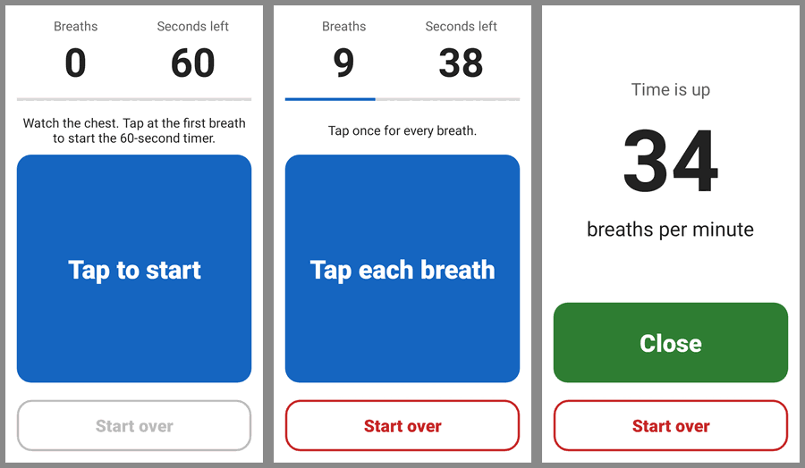

# Breath Counter for ODK

A small Android app for counting a child's respiratory rate. ODK Collect opens it from a form
question, and the health worker taps once for each breath. After 60 seconds it beeps and shows
the count. **Save result** sends the number back to the form.

It is modelled on Dimagi's [breath-counter](https://github.com/dimagi/breath-counter) for
CommCare. It has no third-party libraries, no network access and no sound files. The release
APK is about 20 KB and runs on Android 5.0 or newer.



## How it works

1. Watch the chest. Tap the big button at the **first breath**. That tap counts as breath 1 and
   starts the 60-second timer.
2. Tap once for every breath after that. The screen shows the breaths counted, the seconds left
   and a progress bar.
3. At 60 seconds the phone beeps three times and vibrates, and the result screen appears.
   The beep plays on the alarm channel, so it is heard even when the phone is on silent.
4. **Save result** returns the count to ODK. **Start over** clears the count at any point.

The count is cleared if the user leaves the screen while counting, for example after a phone
call, the home button or the power button. Breaths would have been missed, so the count can't
be trusted. The screen stays on while the app is open. Pressing the back button returns to the
form without saving anything.

## Using it in an ODK form

Add an `integer` question whose appearance launches the app:

| type    | name     | label                          | appearance                           |
|---------|----------|--------------------------------|--------------------------------------|
| integer | resp_rate | Respiratory rate (breaths/min) | `ex:org.taimaka.respirationrate.COUNT` |

ODK Collect shows a **Launch** button for this question. When the user taps **Save result** in the app,
the count fills the question. If the app isn't installed, Collect lets the user type the value
in by hand. The usual `constraint` and `relevant` columns still apply, for example
`. >= 5 and . <= 150`.

The result comes back in two extras:

| Extra             | Used by     | Value                      |
|-------------------|-------------|----------------------------|
| `value`           | ODK Collect | the breath count, as text  |
| `odk_intent_data` | CommCare    | the same value             |

`docs/breath_count_test.xml` is a one-question test form. To try it, copy it into an ODK
Collect project's `forms` folder, for example
`/sdcard/Android/data/org.odk.collect.android/files/projects/<project>/forms/`.

The app can also be opened from the launcher without a form. **Save result** then just closes it.

## Building

You need JDK 17 or newer and the Android SDK, with `ANDROID_HOME` set or `sdk.dir` in
`local.properties`.

```bash
./gradlew assembleDebug
```

The APK is written to `app/build/outputs/apk/debug/app-debug.apk`.

```bash
./gradlew testDebugUnitTest
```

This runs the Robolectric tests in `app/src/test`. They cover counting, the 60-second cutoff,
the returned value, start over, leaving mid-count and rotation.

### Release builds

Release builds are shrunk with R8 and must be signed before Android will install them. Keep the
same key for every release, because Android only installs an update over a version signed with
the same key. Losing the keystore or its password means users have to uninstall the app before
installing a new version.

#### Signing in GitHub Actions

GitHub Actions runs the tests and builds the APKs on every push. When these four repository
secrets are set, it also builds a signed release APK:

| Secret                    | Value                                        |
|---------------------------|----------------------------------------------|
| `RELEASE_KEYSTORE_BASE64` | the keystore file, base64-encoded            |
| `RELEASE_STORE_PASSWORD`  | the keystore password                        |
| `RELEASE_KEY_ALIAS`       | the key alias, for example `breath-counter`  |
| `RELEASE_KEY_PASSWORD`    | the key password (the same as the keystore password for a PKCS12 keystore) |

The signed APK is attached to each run as part of the `apks` artifact, named
`breath-counter-<versionName>.apk`.

To publish a release, raise `versionCode` and `versionName` in `app/build.gradle`, commit, then
push a tag starting with `v`:

```bash
git tag v1.1
```

```bash
git push origin v1.1
```

This creates a GitHub Release with the signed APK attached. Phones only accept an update whose
`versionCode` is higher than the installed one.

The debug APKs from CI are signed with a throwaway key that changes on every run. They are fine
for trying the app, but not for phones in the field.

#### Signing locally

Pass the same details as Gradle properties. They can go in `~/.gradle/gradle.properties` so they
never live in the repository:

```properties
RELEASE_STORE_FILE=/path/to/breath-counter-release.jks
RELEASE_STORE_PASSWORD=...
RELEASE_KEY_ALIAS=...
RELEASE_KEY_PASSWORD=...
```

```bash
./gradlew assembleRelease
```

Without these properties, `app-release-unsigned.apk` is produced instead.

## Changing the app

Everything is in one activity, `app/src/main/java/org/taimaka/respirationrate/MainActivity.java`,
and one layout, `app/src/main/res/layout/activity_main.xml`. All the text is in
`app/src/main/res/values/strings.xml`. To add a language, copy that file to
`values-<code>/strings.xml` (for example `values-ha` for Hausa) and translate it.
